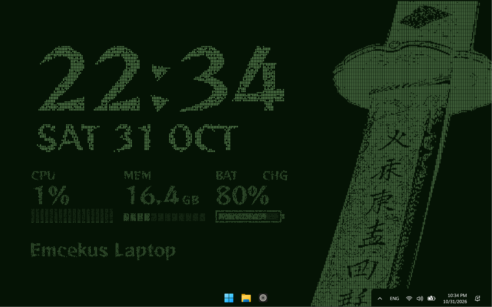

# Katana Desktop

Pixel-grid desktop widgets for [Rainmeter](https://www.rainmeter.net/): a 24-hour clock with date, CPU, memory, battery and a line of your own text. Each widget is drawn out of small green cells with a little random wear, so it looks etched into the same grid as a pixel-art wallpaper.



## Install

1. Install [Rainmeter](https://www.rainmeter.net/) (4.5 or newer, Windows 10/11).
2. Download the latest `KatanaDesktop_x.y.rmskin` from [Releases](../../releases) and double-click it.
3. Keep "Load included layout" ticked. The widgets appear in their default arrangement.

Drag any widget to move it; Rainmeter remembers the position. To change the text, right-click the text widget and choose **Edit text**.

> Loading the layout replaces the skins you currently have loaded. Untick it if you want to add the widgets to an existing setup and load them from Rainmeter's Manage window instead.

## Widgets

| Widget  | Shows |
|---------|-------|
| Clock   | 24-hour time and date (`SAT 31 OCT`) |
| CPU     | Total load and an 18-second history |
| Memory  | Used RAM in GB, bar shows share of total |
| Battery | Charge level; `CHG` while plugged in |
| Text    | Up to 24 characters of printable ASCII |

## How it works

Rainmeter can't do the per-pixel effect live, so the images are pre-rendered:

- `rasterize.js` runs the original canvas drawing code in headless Chromium (Playwright) and records which cells are lit.
- `build.py` turns those cell maps into indexed PNGs, writes the skin `.ini` files, the layout, and packages everything as an `.rmskin`.
- At runtime, small Lua scripts (`skin/Scripts`) swap images and lay out numbers and text glyph by glyph.

The whole suite uses around a megabyte of RAM on top of Rainmeter itself.

## Build from source

Needs Node 18+ and Python 3.10+.

```sh
npm install
npx playwright install chromium
pip install -r requirements.txt
python build.py
```

The installer lands in `dist/`. Options:

| Flag | Default | What it does |
|------|---------|--------------|
| `--wear` | `0.12` | Share of cells knocked out (0–0.3) |
| `--clock-cell` | `4` | Screen pixels per cell for the clock |
| `--cell` | `2` | Screen pixels per cell for the other widgets |

Pushing a tag like `v2.0` builds the `.rmskin` in GitHub Actions and attaches it to a release.

## Credits

Font: [Reggae One](https://github.com/fontworks-fonts/Reggae) by Fontworks, licensed under the SIL Open Font License 1.1 (`fonts/OFL.txt`).
